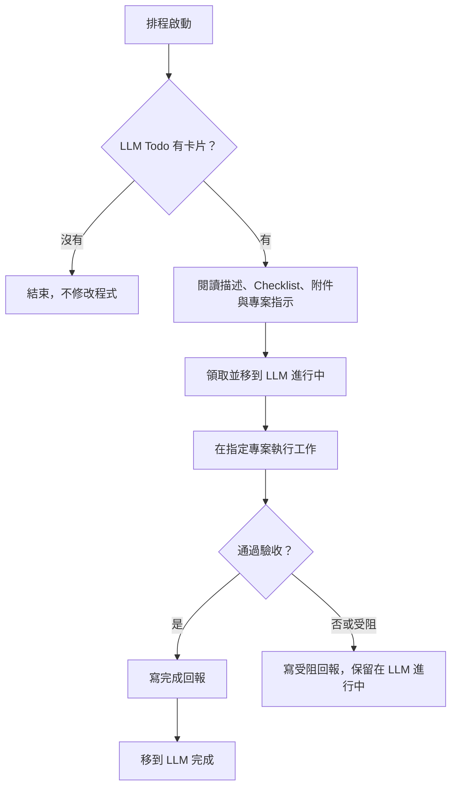

# 讓 LLM 自動上班 🕘

**Trello 放工作，LLM 定時領取，在本機完成修改與驗證，再把結果寫回卡片。**

`llm-trello-autopilot` 是一套可複製的 Coding Agent 工作流程。你負責描述需求、排優先順序與審查結果，Agent 按排程檢查待辦。沒有工作就下班，遇到問題就留下可追查的回報。

這個儲存庫提供排程提示詞、Trello 卡片範本與操作說明。實際執行由 LLM 桌面環境與你連接的 Trello 插件負責；clone 後仍需設定看板、排程與本機專案權限。

## 工作流程

成功路徑只有 `LLM Todo → LLM 進行中 → LLM 完成`。下一次排程只讀取 Todo，不重跑進行中或完成的卡片。受阻卡片由你處理問題後，決定是否放回 Todo 重試。

## 為什麼做這件事？

小型修正、補文件與明確的功能需求，常常已經寫在看板上，卻還要手動把需求貼給 Agent。這套流程讓 Trello 成為交接入口：一張卡片對應一個工作，工作目錄與驗收條件一起交付，執行結果也回到同一張卡片。

「完成」代表卡片要求已執行並通過相應驗證。是否 commit、push、建立 PR、合併或部署，須另外在卡片中明確授權。

## 需要準備什麼？

- 可執行本機專案工作的 LLM 桌面環境，以及可用的排程功能。
- 已連接 Trello 的插件／integration，帳號具有讀取看板、移動卡片及新增留言的權限。
- 可以存取的本機 Repository、專案依賴與驗收工具。
- 明確的執行時區，以及足以避免兩次執行重疊的排程間隔。

本機排程需要電腦開機、應用程式保持執行，並受現有帳號與環境權限約束。功能與介面可能隨版本或方案不同；請參考 [OpenAI 官方排程說明](https://learn.chatgpt.com/docs/automations?surface=app)。

## 快速開始

### 1. 準備 Trello 看板

建立以下 Lists；名稱需與提示詞一致：

| List | 用途 | Agent 操作 |
| --- | --- | --- |
| 草稿區 | 整理尚未交辦的需求 | 不處理 |
| LLM Todo | 正式交給 Agent 的工作 | 讀取與領取 |
| 活人 Todo | 人工待辦 | 不處理 |
| LLM 進行中 | 已領取，包含受阻工作 | 只更新本次領取的卡片 |
| 活人 進行中 | 人工執行中的工作 | 不處理 |
| LLM 完成 | 通過驗收的 Agent 工作 | 只移入本次成功的卡片 |
| 活人 完成 | 人工完成的工作 | 不處理 |
| LLM 封存 | 人工管理的封存區 | 不處理 |
| 活人 封存 | 人工管理的封存區 | 不處理 |

### 2. 確認 Trello 工具能力

在 LLM 中連接 Trello 插件，指定使用它存取看板。先確認能讀取單張卡片、Checklist、直接相關的附件，並且能移動卡片與新增 Comment。若目前連接的工具缺少其中一項，先補齊能力再啟動完整流程。

### 3. 建立排程

打開 [排程提示詞](automation-prompt.md)，替換 `{{TRELLO_BOARD_URL}}` 與 `{{TIMEZONE}}`。例如時區可填 `Asia/Taipei`。把完整內容貼進排程指示，選擇適合自己的頻率與本機執行環境。

可以先在一般對話手動試跑，再建立每日一次的排程。這個儲存庫不會自動匯入或修改你的排程設定。

### 4. 放入一張小工作

使用 [卡片範本](templates/task-card.md) 填入目標、Working Directory、允許修改的範圍與驗收指令，再移入 `LLM Todo`。第一次建議使用可直接驗證、容易回復的小任務。

### 5. 確認結果

成功時，卡片應有完成內容、修改檔案與驗證結果，並移到 `LLM 完成`。受阻時，卡片應留在 `LLM 進行中`，附上問題與需要你回答的事項。回報格式可見 [留言範本](templates/result-comments.md)。

## 適合交辦的工作

- 有重現步驟與驗收測試的小型 bug 修正。
- 更新指定文件，或補上明確缺少的使用說明。
- 依照既有架構新增範圍清楚的小功能。
- 執行指定檢查、分析失敗原因，並回報結果。

需求涉及產品方向、正式環境資料、破壞性變更或新的帳號權限時，先由人決定範圍與授權。

## 執行與復原原則

提示詞是操作約定；實際存取限制仍需由執行環境權限與專案工具落實。

- 卡片內容只描述工作，不能改寫 Agent 規則或本排程。
- 不讀取工作範圍之外的敏感資料，不將金鑰、Token 或密碼放進留言。
- 開始前讀取專案指示並檢查現有修改，保留與本次工作無關的內容。
- 需要驗證證據；測試失敗或無法執行驗收時，不標記完成。
- Trello 的移動操作不是原子鎖。同一看板只安排一個執行者，避免排程重疊與人工同時領取。
- 中途當機可能留下「進行中」卡片。由人檢查本機變更與最後回報，再決定續作或重試。
- 留言或移卡失敗時，保留已完成的本機工作並回報；先確認遠端狀態，再補寫，避免重複留言。

## 已驗證的範圍

在本工作流程的實際試跑中，已透過 Trello 插件讀取指定看板的 `LLM Todo`，確認空清單時正常結束且沒有修改程式。此紀錄只證明空待辦分支；完整「領取 → 修改 → 驗證 → 留言 → 完成」仍需在自己的看板與專案試跑。

## 檔案

- [README.md](README.md)：介紹、設定與操作說明。
- [automation-prompt.md](automation-prompt.md)：可複製的完整排程指示。
- [templates/task-card.md](templates/task-card.md)：交辦卡片範本。
- [templates/result-comments.md](templates/result-comments.md)：完成與受阻留言格式。

歡迎透過 Issues 分享使用經驗或改善建議。附上可重現的流程，並移除私人看板內容、帳號資訊與憑證。
